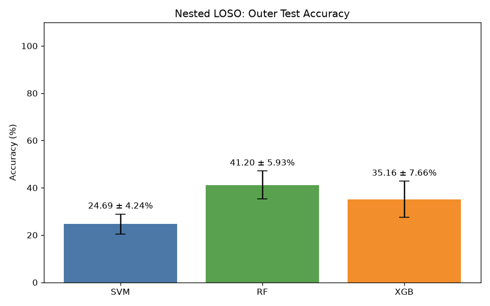
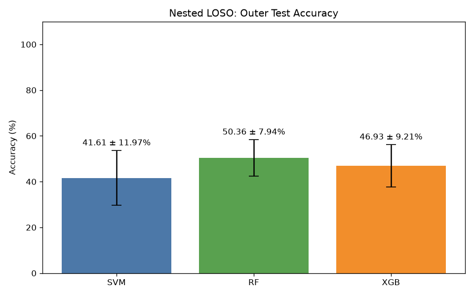
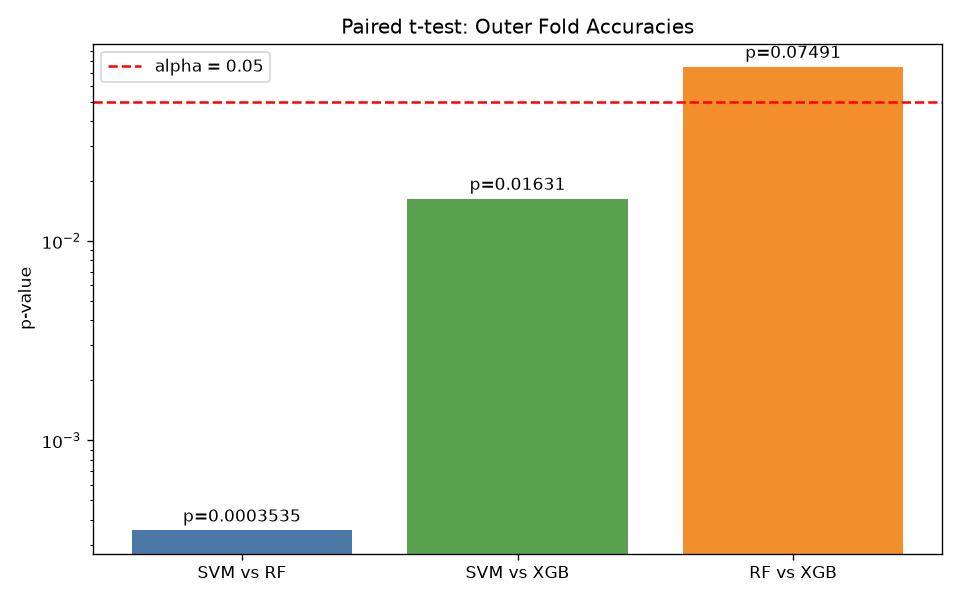
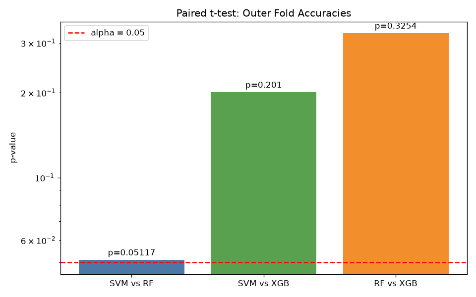
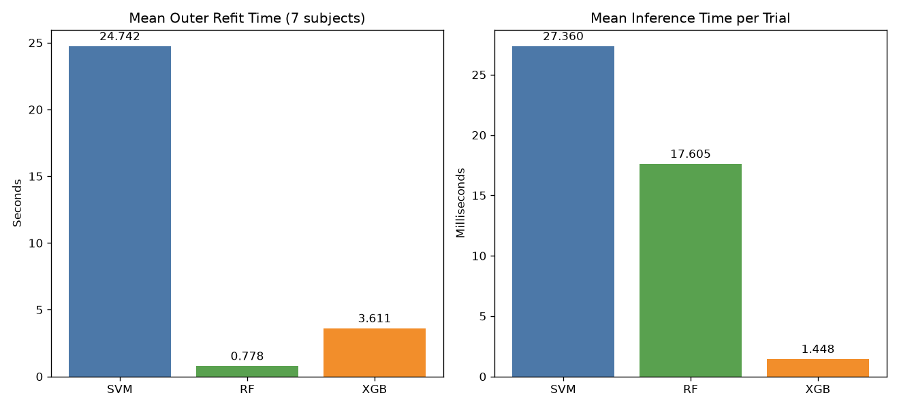
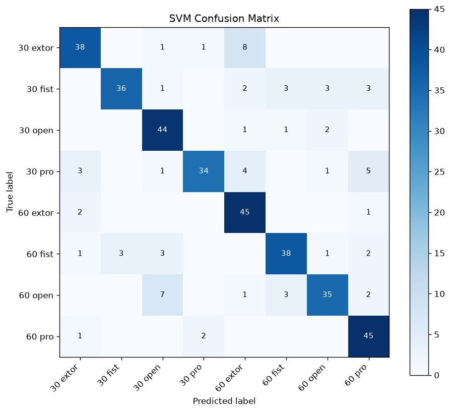
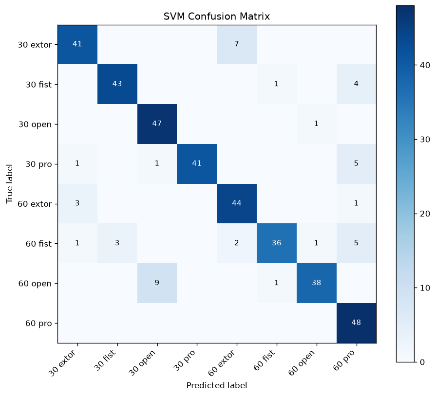
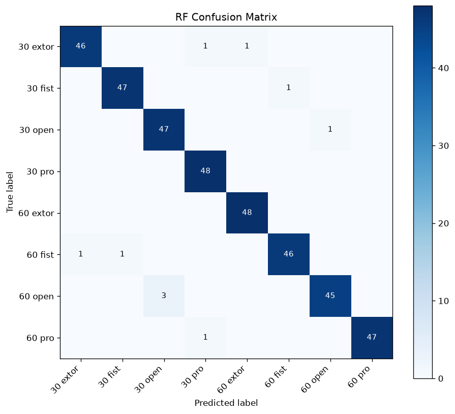
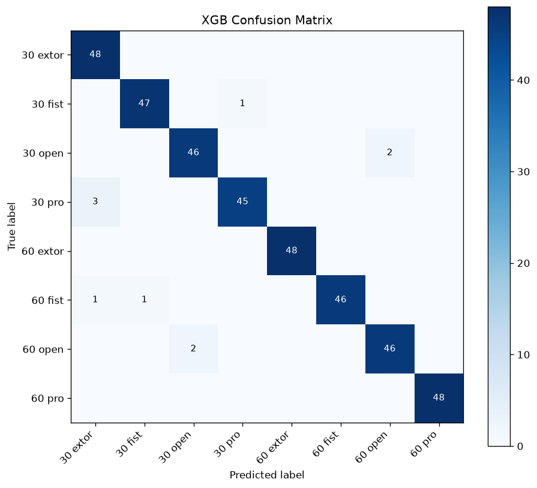
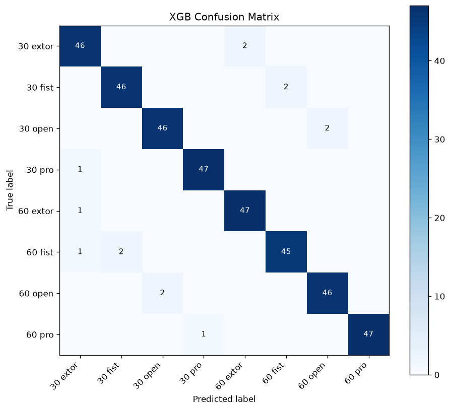

# <center>표면 근전도(sEMG) 신호를 활용한 손동작 및 팔꿈치 각도의 동시 분류 재현 및 시간축 정렬 유무에 따른 영향 분석</center>

## 1. 코드 설명

본 프로젝트는 8명의 참가자(`a`~`h`)에게서 수집한 5채널 sEMG 신호를 이용해 손동작 4종(`extor`, `fist`, `open`, `pro`)과 팔꿈치 각도 2종(30°, 60°)의 조합인 8개 클래스를 분류한다.

### 사용 데이터 및 전처리 방법

- 샘플링 주파수: 1,000 Hz
- 전체 데이터: 64개 CSV, 1,920개 시행(파일별 30개 시행)
- 시행 구분: `mark=1`을 시작점으로 하는 5초(5,000샘플) 구간
- 신호 채널: ECR, ED, FDS, Biceps, Triceps의 5채널
- 필터: 60 Hz notch filter(Q=30) 적용 후 20~450 Hz 4차 Butterworth band-pass filter 적용
- 필터링 방식: `filtfilt`를 사용한 영위상 필터링
- 분석 구간: 시행 시작 1.5초부터 3.5초까지의 2초 구간(2,000샘플)
- 윈도우: 200 ms(200샘플), 100 ms hop, 50% overlap으로 시행당 19개 생성
- 시간영역 특징: 채널별 RMS, MAV, WL, ZC, SSC를 계산하여 윈도우당 25차원 특징 생성
- 데이터 분할: 각 파일의 시행을 먼저 8:2로 분할하여 학습 1,536개, 테스트 384개 시행 구성
- 표준화: 학습 데이터에만 `StandardScaler`를 적합하고 테스트 데이터에는 변환만 적용
- 클래스 분포: 8개 클래스마다 학습 192개, 테스트 48개 시행으로 균등 구성

시행마다 다른 근활성 시작점을 2초 위치로 맞추는 onset 정렬 코드를 구현했다. Ch2~Ch4 기반 단계형 검출을 우선 적용하고, 실패 시 Ch1~Ch5 전체 채널을 사용하는 fallback과 시행별 QC 보고서를 제공한다. 정렬 효과를 확인하기 위해 데이터 구조, 분할, 특징, 모델 파라미터 및 평가 방법은 같게 유지하고 입력 데이터만 다르게 구성했다.

| 구분          | 데이터셋                             | 입력 CSV        | 모델                                 | 5-fold 결과                   | 혼동행렬                      |
| ------------- | ------------------------------------ | --------------- | ------------------------------------ | ----------------------------- | ----------------------------- |
| 시간축 미정렬 | `data/dataset_improve.npz`           | `data/data`     | `data/machine learning/no_time_axis` | `data/five fold/no_time_axis` | `output/figures/no_time_axis` |
| 시간축 정렬   | `data/dataset_improve_time_axis.npz` | `data/data_pre` | `data/machine learning/time_axis`    | `data/five fold/time_axis`    | `output/figures/time_axis`    |

### 사용 모델

- SVM: RBF 커널, `C=1.0`, `gamma=scale`
- Random Forest(RF): 결정 트리 100개, `random_state=42`
- XGBoost(XGB): 결정 트리 400개, 최대 깊이 6, 학습률 0.05

각 모델은 학습 시행의 19개 윈도우를 개별 학습 표본으로 사용한다. 평가할 때는 같은 시행에 속한 19개 윈도우의 확률 또는 결정 점수를 평균하여 시행당 하나의 클래스를 예측한다.

### 학습 및 테스트 방법

최종 hold-out 평가는 학습 1,536개 시행과 테스트 384개 시행을 사용한다. 추가로 전체 1,920개 시행에 대해 `StratifiedKFold` 기반 5-fold 교차검증을 수행하며, 각 fold의 학습 데이터로만 표준화 통계를 계산한다. 평가지표는 Accuracy, macro Precision, macro Recall, macro F1-score이다.

참가자 간 일반화 성능은 별도의 nested LOSO로 평가했다. 외부 8개 fold에서 참가자 1명(240개 시행)을 Test로 격리하고, 나머지 7명 안에서 Train 6명(1,440개 시행)·Validation 1명(240개 시행)을 7회 순환했다. 내부 검증 평균 정확도로 모델별 설정을 선택한 뒤, 외부 학습 참가자 7명(1,680개 시행)으로 다시 학습하여 Test 정확도를 계산했다. 모든 fold에서 학습은 윈도우 단위, 평가는 시행 단위로 수행했다.

LOSO 데이터셋은 전체 참가자의 표준화 전 특징 `X`, 라벨 `y`, 피험자 `subjects`, 시행 ID `trial_ids`를 저장한다. `StandardScaler`는 내부 검증 시 Train 6명, 최종 재학습 시 7명으로만 적합한다. 기존 hold-out·5-fold의 고정 설정과 달리, nested LOSO에서는 SVM의 `C`(0.1, 1.0, 10.0), RF의 `max_depth`(None, 10), XGB의 `max_depth`(6, 3)를 탐색하며 나머지 설정은 유지했다. 정렬·미정렬은 동일한 참가자 분할과 후보 설정을 사용하되, 최종 설정은 각 조건의 내부 검증에서 따로 선택했다.

| 구분          | LOSO 데이터셋                          | 결과 저장 경로           |
| ------------- | -------------------------------------- | ------------------------ |
| 시간축 미정렬 | `data/loso/dataset_loso.npz`           | `data/loso/no_time_axis` |
| 시간축 정렬   | `data/loso/dataset_time_axis_loso.npz` | `data/loso/time_axis`    |

### 실행 방법

프로젝트 루트에서 다음 순서로 실행한다.

```powershell
.\.venv\Scripts\python.exe -m pip install -r requirements.txt
.\.venv\Scripts\python.exe -m src.preprocess.dataset_maker
.\.venv\Scripts\python.exe -m src.machine_learning
.\.venv\Scripts\python.exe -m src.hold_out
.\.venv\Scripts\python.exe -m src.confusion_matrix
.\.venv\Scripts\python.exe -m src.five_fold
```

onset 정렬 결과와 QC 보고서가 필요하면 다음 명령을 별도로 실행한다.

```powershell
.\.venv\Scripts\python.exe -m src.preprocess.data_time_axis
```

정렬 데이터 비교에서는 `machine_learning.py`, `hold_out.py`, `confusion_matrix.py`, `five_fold.py`의 학습·평가 로직은 수정하지 않고 `DATASET_PATH`, 모델 경로와 출력 경로만 위의 데이터 구분표에 맞게 사용했다. 비교 실행 후 네 평가 파일의 기본 상수는 기존 미정렬 경로로 유지했다.

nested LOSO 데이터셋 생성과 학습·평가는 다음 명령으로 별도 실행한다. 두 파일은 프로젝트의 `.venv` Python을 선택한 IDE의 Run 버튼으로도 실행할 수 있다.

```powershell
.\.venv\Scripts\python.exe -m src.preprocess.dataset_maker_loso
.\.venv\Scripts\python.exe -m src.loso_8_fold
```

### 코드 설명

| 파일                                   | 설명                                                                            |
| -------------------------------------- | ------------------------------------------------------------------------------- |
| `src/preprocess/data_time_axis.py`     | 시행별 근활성 onset 검출, 2초 기준 시간축 정렬, 빈 구간 보완 및 QC 보고서 생성  |
| `src/preprocess/data_preprocess.py`    | notch/band-pass 필터링, 분석 구간 절단, 윈도우 생성 및 시간영역 특징 추출       |
| `src/preprocess/dataset_maker.py`      | 시행 단위 학습·테스트 분할, 특징 데이터셋 생성 및 표준화                        |
| `src/preprocess/dataset_maker_loso.py` | 동일한 시행별 전처리로 참가자 정보를 포함한 미정렬·정렬 LOSO 통합 데이터셋 생성 |
| `src/machine_learning.py`              | SVM, RF, XGB 학습과 모델·라벨 인코더 저장                                       |
| `src/hold_out.py`                      | 384개 테스트 시행의 Accuracy, Precision, Recall, F1-score 평가                  |
| `src/five_fold.py`                     | 시행 단위 5-fold 교차검증, 대응표본 t-검정 및 실행시간 비교                     |
| `src/loso_8_fold.py`                   | 외부 8-fold·내부 7-fold nested LOSO, 설정 선택 및 참가자별 평가 결과 저장       |
| `src/confusion_matrix.py`              | 모델별 8클래스 혼동행렬 생성 및 주요 오분류 출력                                |
| `src/drowingSignal.py`                 | 단일 시행의 5채널 신호 시각화                                                   |
| `src/drowingSigmalDual.py`             | 30°와 60° 신호 비교 시각화                                                      |

## 2. 모델 성능 비교

미정렬 결과는 `dataset_improve.npz` 재실행값이며, 정렬 결과는 `dataset_improve_time_axis.npz`로 같은 날 동일한 모델과 평가 코드를 실행한 값이다.

### Hold-out 테스트 결과

| Model         | 데이터 |   Accuracy |  Precision |     Recall |   F1-score |
| ------------- | ------ | ---------: | ---------: | ---------: | ---------: |
| SVM           | 미정렬 |     82.03% |     83.12% |     82.03% |     81.91% |
| SVM           | 정렬   | **88.02%** | **89.25%** | **88.02%** | **88.01%** |
| Random Forest | 미정렬 |     97.14% |     97.22% |     97.14% |     97.13% |
| Random Forest | 정렬   | **97.40%** | **97.43%** | **97.40%** | **97.39%** |
| XGBoost       | 미정렬 | **97.40%** | **97.46%** | **97.40%** | **97.40%** |
| XGBoost       | 정렬   |     96.35% |     96.37% |     96.35% |     96.36% |

### 5-fold 교차검증 결과

| Model         |   미정렬 Accuracy |     정렬 Accuracy | 정렬에 따른 변화 |
| ------------- | ----------------: | ----------------: | ---------------: |
| SVM           |     76.77 ± 1.50% | **85.47 ± 2.20%** |      **+8.70%p** |
| Random Forest |     97.40 ± 0.44% | **97.50 ± 1.25%** |      **+0.10%p** |
| XGBoost       | **97.03 ± 0.54%** |     96.67 ± 0.98% |          -0.36%p |

왼쪽은 시간축 미정렬, 오른쪽은 시간축 정렬 결과이다.

<p align="center">
  
  
</p>

### 성능 분석

시간축 정렬은 SVM의 hold-out 정확도를 5.99%p, 5-fold 평균 정확도를 8.70%p 높여 가장 뚜렷한 개선을 보였다. Random Forest는 hold-out에서 0.26%p, 5-fold에서 0.10%p 향상되어 두 조건 모두 약 97%의 안정적인 성능을 유지했다. 반면 XGBoost는 hold-out에서 1.05%p, 5-fold에서 0.36%p 낮아져 시간축 정렬이 모든 모델에 일관된 이점을 주지는 않았다.

### 통계 검정 결과

각 데이터 조건에서 동일한 5개 fold의 모델별 정확도를 이용해 대응표본 t-검정을 수행했다.

| 비교 모델  | 미정렬 t | 미정렬 p | 미정렬 판정 |   정렬 t |   정렬 p | 정렬 판정     |
| ---------- | -------: | -------: | ----------- | -------: | -------: | ------------- |
| SVM vs RF  | -25.3773 | 0.000014 | 유의함      | -11.9129 | 0.000284 | 유의함        |
| SVM vs XGB | -24.4321 | 0.000017 | 유의함      |  -9.9437 | 0.000574 | 유의함        |
| RF vs XGB  |   5.7155 | 0.004636 | 유의함      |   2.1875 | 0.093957 | 유의하지 않음 |

<p align="center">
  
  
</p>

SVM은 두 데이터 조건 모두 RF와 XGB보다 유의하게 낮았다. 미정렬 데이터에서는 RF와 XGB의 차이도 유의했지만, 정렬 데이터에서는 두 모델의 차이가 유의하지 않았다. 단, 검정 표본이 5개 fold로 제한되므로 통계 결과는 보조 지표로 해석한다.

### 계산 비용 결과

학습 시간은 hold-out 학습 데이터 전체로 한 번 학습한 시간이며, 추론 시간은 시행 1개(19개 윈도우)의 예측을 100회 반복한 평균이다.

| Model         | 미정렬 학습 | 정렬 학습 | 미정렬 추론 | 정렬 추론 |
| ------------- | ----------: | --------: | ----------: | --------: |
| SVM           |    18.931초 |  18.634초 |   22.437 ms | 22.573 ms |
| Random Forest |     1.062초 |   1.260초 |   16.224 ms | 16.650 ms |
| XGBoost       |     3.635초 |   4.772초 |    2.265 ms |  2.478 ms |

<p align="center">
  
  
</p>

두 조건 모두 Random Forest의 학습이 가장 빨랐고 XGBoost의 시행당 추론이 가장 빨랐다. 실행시간은 운영체제 부하와 하드웨어 상태에 영향을 받으므로 정렬 여부에 따른 작은 차이보다는 모델 간 상대적 계산 비용을 비교하는 참고값으로 사용한다.

### Nested LOSO 교차검증 결과

아래 결과는 외부 Test 참가자 a~h의 정확도 평균과 표준편차이며, 각 시행은 외부 Test에 한 번씩 포함되어 총 1,920개 시행을 평가했다. 기존 시행 단위 5-fold와 평가 대상 및 설정 선택 절차가 다르므로 별도 실험으로 해석한다.

| Model         | 미정렬 Accuracy |      정렬 Accuracy | 정렬에 따른 변화 | 개선된 참가자 |
| ------------- | --------------: | -----------------: | ---------------: | ------------: |
| SVM           |   24.69 ± 4.24% | **41.61 ± 11.97%** |     **+16.93%p** |     8명 / 8명 |
| Random Forest |   41.20 ± 5.93% |  **50.36 ± 7.94%** |      **+9.17%p** |     7명 / 8명 |
| XGBoost       |   35.16 ± 7.66% |  **46.93 ± 9.21%** |     **+11.77%p** |     7명 / 8명 |

변화량은 반올림 전 정확도로 계산했다. 왼쪽은 시간축 미정렬, 오른쪽은 시간축 정렬 결과이다.

<p align="center">
  
  
</p>

### LOSO 참가자별 성능 분석

| Test 참가자 | SVM 미정렬 | SVM 정렬 | RF 미정렬 | RF 정렬 | XGB 미정렬 | XGB 정렬 |
| ----------- | ---------: | -------: | --------: | ------: | ---------: | -------: |
| a           |     30.00% |   38.33% |    38.75% |  60.00% |     29.17% |   45.42% |
| b           |     23.33% |   35.83% |    43.33% |  47.92% |     27.08% |   31.67% |
| c           |     24.17% |   47.08% |    41.25% |  50.00% |     47.92% |   57.08% |
| d           |     29.58% |   67.50% |    36.67% |  55.42% |     39.58% |   57.50% |
| e           |     24.58% |   31.67% |    46.25% |  51.67% |     37.08% |   56.67% |
| f           |     28.33% |   50.00% |    50.42% |  60.00% |     35.42% |   49.17% |
| g           |     20.42% |   34.17% |    29.58% |  42.50% |     23.33% |   40.00% |
| h           |     17.08% |   28.33% |    43.33% |  35.42% |     41.67% |   37.92% |

SVM은 모든 참가자에서 정렬 후 정확도가 증가했고, RF와 XGB는 h를 제외한 7명에서 개선됐다. h의 RF는 7.92%p, XGB는 3.75%p 감소하여 정렬 효과에 개인차가 나타났다. 다만 다른 참가자에서도 기존 약 97% 수준에 도달하지 못했으므로, 성능 하락을 특정 참가자 한 명의 특성만으로 설명할 수는 없다. 정렬 후 평균 성능은 높아졌지만 참가자 간 표준편차도 커져, 모든 참가자에게 균일한 개선을 제공하지는 않았다.

### LOSO 동작·각도 혼동 분석

저장된 `loso_8_fold_results.json`의 시행별 정답과 예측 라벨을 동작·각도로 나누어 추가 집계했다. 아래 값은 별도의 동작·각도 모델 성능이 아니라, 기존 8클래스 예측에서 각 항목만 맞았는지를 계산한 값이다.

| Model         | 미정렬 동작 정확도 | 정렬 동작 정확도 | 미정렬 각도 정확도 | 정렬 각도 정확도 |
| ------------- | -----------------: | ---------------: | -----------------: | ---------------: |
| SVM           |             54.11% |           73.75% |             46.41% |           54.38% |
| Random Forest |             75.21% |           86.51% |             51.56% |           56.82% |
| XGBoost       |             61.98% |           83.44% |             52.03% |           54.69% |

정렬 RF는 동작 정확도가 86.51%였지만 각도 정확도는 56.82%에 머물렀다. 전체 오류 953건 중 694건(72.82%)은 동작은 맞고 각도만 틀린 경우였다. 주요 오분류는 `30 extor → 60 extor` 141건, `60 fist → 30 fist` 108건, `30 pro → 60 pro` 99건, `30 open → 60 open` 96건이었다. 각 실제 클래스는 240개 시행으로 구성된다. 따라서 현재 참가자 독립 분류에서는 팔꿈치 각도 구분이 주요 성능 제한 요인으로 나타났다.

### LOSO 통계 검정 결과

각 조건에서 동일한 8개 외부 fold의 모델별 정확도를 대응 비교했다. 아래 검정은 모델 간 차이를 다루며, 정렬 전후 효과를 직접 검정한 것은 아니다.

| 비교 모델  | 미정렬 p | 미정렬 판정   |   정렬 p | 정렬 판정     |
| ---------- | -------: | ------------- | -------: | ------------- |
| SVM vs RF  | 0.000353 | 유의함        | 0.051169 | 유의하지 않음 |
| SVM vs XGB | 0.016314 | 유의함        | 0.200976 | 유의하지 않음 |
| RF vs XGB  | 0.074908 | 유의하지 않음 | 0.325355 | 유의하지 않음 |

<p align="center">
  
  
</p>

정렬 후 RF의 평균 정확도가 가장 높았지만, 모델 간 차이는 유의수준 0.05에서 유의하지 않았다. 이는 모델 성능이 동등하다는 의미는 아니다. 참가자가 8명으로 적고 fold 간 학습 데이터가 겹치며 다중비교 보정을 하지 않았으므로, 통계 결과는 탐색적 보조 지표로 해석한다.

### LOSO 계산 비용 결과

학습 시간은 내부 후보 탐색을 제외하고, 선택된 설정으로 외부 학습 참가자 7명을 재학습한 시간의 8개 fold 평균이다. 추론 시간은 각 fold의 시행 1개에 대해 100회 측정한 평균을 다시 fold 간 평균한 값이다.

| Model         | 미정렬 학습 | 정렬 학습 | 미정렬 추론 | 정렬 추론 |
| ------------- | ----------: | --------: | ----------: | --------: |
| SVM           |    22.529초 |  24.742초 |   25.811 ms | 27.360 ms |
| Random Forest |     0.880초 |   0.778초 |   16.837 ms | 17.605 ms |
| XGBoost       |     3.121초 |   3.611초 |    1.497 ms |  1.448 ms |

<p align="center">
  
  
</p>

LOSO에서도 RF의 재학습과 XGB의 시행당 추론이 가장 빨랐다. 위 시간은 전체 nested LOSO 실행시간이 아니며, 기존 hold-out과 학습 표본 수 및 선택 설정도 달라 직접적인 속도 개선으로 해석하지 않는다.

### LOSO 해석의 한계

피험자별 분리와 fold별 학습 데이터 기반 표준화로 참가자 간 학습·검증·테스트 누수를 방지했다. 다만 기존 정렬 CSV에는 같은 파일·같은 클래스의 다른 시행을 이용한 빈 구간 보완이 포함되어 있으므로, 이번 결과가 시행 간 완전 독립 전처리나 정답을 모르는 실시간 입력 조건까지 검증한 것은 아니다. 또한 정렬·미정렬에서 내부 검증으로 설정을 각각 선택했으므로, 성능 차이는 각 조건에서 설정 선택을 포함한 전체 학습 절차의 차이로 해석한다.

## 3. Confusion Matrix 분석

각 그림의 왼쪽은 시간축 미정렬, 오른쪽은 시간축 정렬 결과이며 모든 혼동행렬의 합계는 384개이다.

### SVM

<p align="center">
  
  
</p>

- 미정렬: `60 extor`, `60 pro`가 각 93.75%로 가장 높고 `30 pro`가 70.83%로 가장 낮았다. 전체 오분류는 69건이었다.
- 정렬: `60 pro`가 100%로 가장 높고 `60 fist`가 75.00%로 가장 낮았다. 전체 오분류는 46건으로 23건 감소했다.
- 주요 변화: 정렬 후 `30 pro` 성능은 70.83%에서 85.42%로 개선됐지만 `60 fist`는 79.17%에서 75.00%로 낮아졌다.

### Random Forest

<p align="center">
  
  
</p>

- 미정렬: `30 extor`, `30 open`, `60 extor`를 100% 분류했으며 전체 오분류는 11건이었다.
- 정렬: `30 pro`, `60 extor`를 100% 분류했으며 전체 오분류는 10건이었다.
- 주요 변화: 두 조건 모두 가장 큰 오류는 `60 open → 30 open` 3건으로, 정렬 후에도 동일 동작의 각도 구분이 주요 오분류로 남았다.

### XGBoost

<p align="center">
  
  
</p>

- 미정렬: `30 extor`, `60 extor`, `60 pro`를 100% 분류했으며 전체 오분류는 10건이었다.
- 정렬: `30 pro`, `60 extor`, `60 pro`가 각 97.92%로 가장 높고 전체 오분류는 14건이었다.
- 주요 변화: 정렬 후 오류가 4건 증가했으며 `extor`, `fist`, `open`에서 주로 30°와 60°를 서로 혼동했다.

## 4. 최종 결과

- 기존 hold-out·5-fold에서 시간축 정렬의 효과: SVM에서 가장 큰 개선이 나타났고 RF는 유사한 성능을 유지했으며 XGB는 소폭 하락했다.
- 미정렬 최고 성능: hold-out은 XGBoost 97.40%, 5-fold 평균은 Random Forest 97.40%였다.
- 정렬 최고 성능: hold-out과 5-fold 평균 모두 Random Forest가 각각 97.40%, 97.50%로 가장 높았다.
- 기존 5-fold 통계 결과: 정렬 후에도 SVM과 두 트리 모델의 차이는 유의했지만 RF와 XGB의 차이는 유의하지 않았다.
- nested LOSO 결과: 정렬 후 SVM 41.61%, RF 50.36%, XGB 46.93%로 미정렬 대비 각각 16.93%p, 9.17%p, 11.77%p 개선됐다. 최고 평균 성능은 정렬 RF였으나 참가자 간 일반화에는 여전히 한계가 있었다.
- LOSO 주요 오류: 정렬 RF의 동작 정확도는 86.51%, 각도 정확도는 56.82%로, 같은 동작에서 30°·60°를 혼동하는 문제가 주요 오류로 남았다.
- 남은 확인 사항: 원 논문의 정확한 2초 분석 구간과 19개 윈도우 결합 방식이 명시되지 않아 완전한 수치 재현에는 한계가 있다.

### 전체적인 실험 결과 및 느낀 점

표면 근전도(sEMG) 신호를 이용해 손동작 4종과 팔꿈치 각도 2종의 조합을 분류한 결과, Random Forest와 XGBoost가 약 97%의 높은 정확도를 보였다. 기존 시행 단위 검증에서 시간축 정렬은 SVM의 성능을 뚜렷하게 개선했지만 트리 기반 모델에서는 영향이 제한적이어서, 정렬 효과가 모델 특성에 따라 다르게 나타남을 확인했다. 다만 같은 참가자가 학습과 테스트에 포함되는 검증이므로, 새로운 참가자에 대한 일반화 성능은 추가 검증이 필요했다. 이에 8명의 참가자 중 1명을 테스트 데이터로 순환 격리하는 nested LOSO 검증을 실행한 결과, 평균 정확도가 미정렬에서 SVM 24.69%, Random Forest 41.20%, XGBoost 35.16%였고 정렬 후에는 각각 41.61%, 50.36%, 46.93%로 높아졌다. 정렬에 따른 개선 폭은 각각 16.93%p, 9.17%p, 11.77%p였으며, SVM은 8명 모두에서, RF와 XGB는 7명에서 개선됐다. 데이터 정렬이 참가자 간 일반화에도 도움이 되는 경향을 확인했지만, 기존 시행 단위 검증보다 LOSO 결과가 낮아 현재의 방법은 같은 참가자의 반복 시행에는 잘 맞고 참가자가 바뀌면 일반화가 어렵다는 것을 알 수 있다. 특히 정렬 RF에서도 동작 정확도 86.51%에 비해 각도 정확도가 56.82%로 낮아, 팔꿈치 각도 구분이 주요 개선 과제로 남았다.

본 실험을하며 학습 데이터의 패턴 일관성 등 품질면에서 중요성을 깊이 깨달았고 데이터의 품질뿐만이 아니라 모델의 차이, 전처리 등 다양한 요소에서 모델 학습의 품질을 결정하는 요소가 될 수 있다고 생각하게 되었다. 특히 이번에 시간정렬로 데이터를 준비하고 비교 분석을 한 결과 데이터 전처리 과정이 같은 데이터라도 어떻게 성능을 끌어올리고 문제를 해결할 수 있는지를 가르는 중요한 지점이라고 생각하게 되었다.
